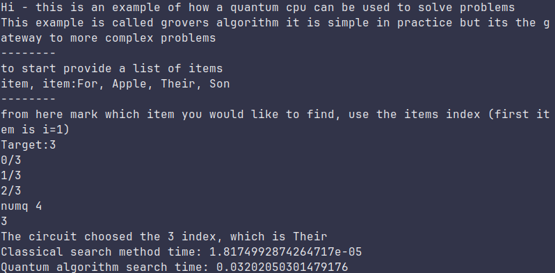
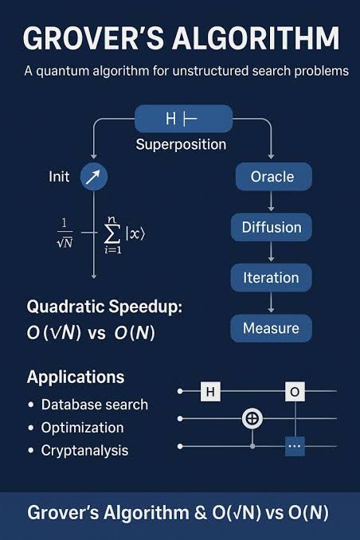

# Quantum CPU - Grovers Algorithm

    an emulator/simulator for a 30 quibit quantum cpu, currently configured to run grovers algorithm.

## Features

    - modular design
    - 8 gates from one quibit to two quibit gates
    - tui interface for usage
    - written program notes for learning resource

## Grovers Algorithm
    Quantum computing is an infant subject that still is growing and devoping and one of the most basic algorithms in computing is the grover algorithm.
    It works by finding a index from a target of a list, it makes use of an oracle function which essentially just marks the amplitude to track. This in
    practice doesnt actually necessarly find it itself or solve something but instead makes use of gates to show how a value can be marked which can later
    solve problems. One thing to note is that grovers algorithm scales with paramaters, however due to a simulator running on computer hardware, scaling
    isnt possible, so in most cases it is simply faster to use a classical algorithm then Grovers.

## How to use

1. Requirements
    - git
    - python

2. Clone repo
    run this to clone repo into a folder:
         ` git clone https://github.com/Cunning077/Quantum_Cpu.git`

3. Install dependencies

	create a venv environment and then open it
		` python3 -m venv .venv` 
		`source .venv/bin/activate` 

	This will install the necessary dependencies to run the bot
		`pip install -r requirements.txt`

4. Run the program
    Use the command:
    	` python app.py` 

## Final Notes
    Make use of the notes and, look into the gates how they work and come up with you own algorithms, this project is for sure going to be continued but
    for this session, grovers is a good point to stop. Thanks for reading and hope you enjoy
